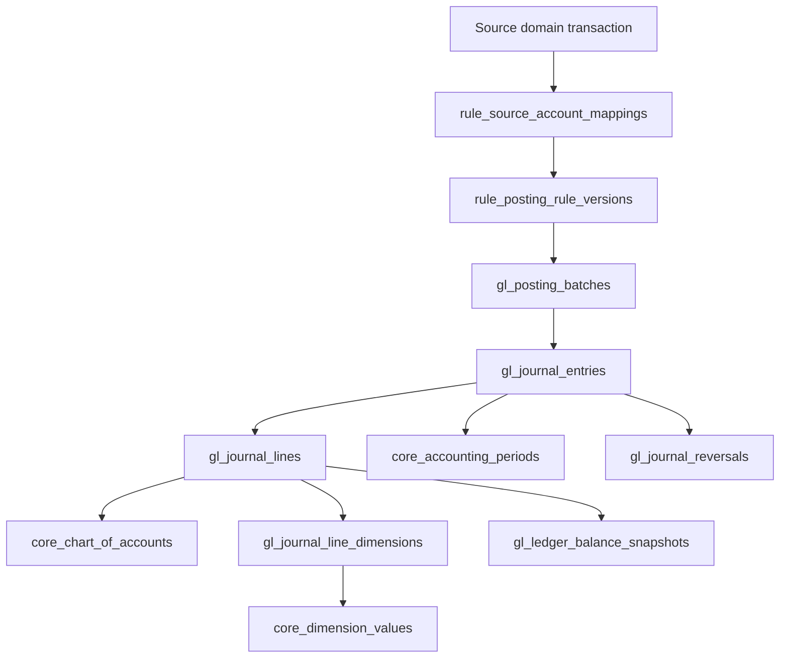

# HMS Financial Operations Architecture

## 1. Database decision

All finance-owned relational tables live in **one PostgreSQL schema: `finance`**. Do not create `finance_gl`, `finance_ar`, `finance_ap`, `finance_cash`, `finance_budget`, or other finance-specific PostgreSQL schemas.

Logical separation remains explicit through table prefixes, table relationships, constraints, indexes, table-level privileges, service boundaries, and documentation. This is a namespace simplification, not a reason to collapse concepts into generic tables.

Non-finance domains remain in their owning schemas: clinical, patient, operational billing, inventory, procurement, IAM, audit, workflow, etc.

## 2. Ownership

- `hms_database`: owns `finance` DDL, migrations, keys, constraints, indexes, relationships and data dictionary.
- `hms_services`: owns posting, approvals, authorization, financial workflows, idempotency, transaction boundaries and reconciliation execution.
- `hms_workspace`: owns presentation and operator interaction. Clients never connect directly to PostgreSQL.

The `finance` schema stores accounting/financial records. It does not automatically own operational source records. Use stable source references to clinical, billing, inventory, procurement and other domains; avoid duplicating their operational data.

## 3. Table groups in the single schema

| Prefix | Logical domain | Example tables |
|---|---|---|
| `core_` | Foundation | `core_legal_entities`, `core_accounting_periods`, `core_chart_of_accounts`, `core_currencies`, `core_dimensions`, `core_dimension_values`, `core_financial_parties` |
| `gl_` | General ledger | `gl_posting_batches`, `gl_journal_entries`, `gl_journal_lines`, `gl_journal_line_dimensions`, `gl_journal_reversals`, `gl_ledger_balance_snapshots` |
| `rule_` | Posting rules | `rule_posting_rules`, `rule_posting_rule_versions`, `rule_source_account_mappings` |
| `ar_` | Receivables | `ar_debtors`, `ar_invoices`, `ar_invoice_lines`, `ar_receipts`, `ar_receipt_allocations`, `ar_credit_notes`, `ar_aging_snapshots`, `ar_allowance_assessments` |
| `ap_` | Payables | `ap_creditors`, `ap_bills`, `ap_bill_lines`, `ap_payment_requests`, `ap_payments`, `ap_payment_allocations`, `ap_advances`, `ap_withholding_records` |
| `cash_` | Cash and bank | `cash_accounts`, `cash_transactions`, `cash_transfers`, `cash_bank_statements`, `cash_bank_statement_lines`, `cash_reconciliations`, `cash_reconciliation_matches`, `cash_payment_settlements` |
| `billing_` | Finance-owned billing records only | `billing_charge_documents`, `billing_charge_lines`, `billing_adjustments`, `billing_invoice_links` |
| `budget_` | Budget | `budget_headers`, `budget_lines`, `budget_revisions`, `budget_commitments`, `budget_actual_links` |
| `asset_` | Fixed assets | `asset_classes`, `asset_register`, `asset_books`, `asset_depreciation_runs`, `asset_depreciation_lines`, `asset_movements` |
| `tax_` | Tax | `tax_codes`, `tax_transactions`, `tax_withholding_records`, `tax_reporting_periods`, `tax_return_lines` |
| `cost_` | Cost accounting | `cost_centres`, `cost_pools`, `cost_drivers`, `cost_allocation_rules`, `cost_allocation_runs`, `cost_allocation_lines`, `cost_unit_cost_snapshots` |
| `control_` | Financial controls | `control_approval_requests`, `control_approval_actions`, `control_period_close_runs`, `control_period_close_tasks`, `control_reconciliation_runs`, `control_reconciliation_items`, `control_exceptions` |

Use `core_financial_parties` only if finance requires its own debtor/creditor accounting identity or immutable snapshot. Do not duplicate platform organizations, IAM users, patient records, or operational supplier masters.

If operational billing already exists in another schema, do not duplicate tariffs, service catalogues, encounter charges or claim workflows. Keep only the finance-owned charge snapshot/receivable/invoice records and source references needed for accounting.

## 4. Core table relationships

| Parent | Child | Cardinality | Meaning |
|---|---|---:|---|
| `core_legal_entities` | `core_fiscal_years` | 1:N | Entity owns fiscal years |
| `core_fiscal_years` | `core_accounting_periods` | 1:N | Fiscal year contains periods |
| `core_legal_entities` | `core_chart_of_accounts` | 1:N | Entity owns/assigns COA |
| `core_account_groups` | `core_chart_of_accounts` | 1:N | Group classifies accounts |
| `gl_posting_batches` | `gl_journal_entries` | 1:N | Batch groups journals |
| `core_accounting_periods` | `gl_journal_entries` | 1:N | Journal is posted in period |
| `gl_journal_entries` | `gl_journal_lines` | 1:N | Journal contains lines |
| `core_chart_of_accounts` | `gl_journal_lines` | 1:N | Each line posts to an account |
| `gl_journal_lines` | `gl_journal_line_dimensions` | 1:N | Line has dimension assignments |
| `core_dimension_values` | `gl_journal_line_dimensions` | 1:N | Dimension value classifies line |
| `rule_posting_rules` | `rule_posting_rule_versions` | 1:N | Rule has immutable versions |
| `rule_posting_rule_versions` | `rule_source_account_mappings` | 1:N | Version contains mappings |
| `core_financial_parties` | `ar_debtors` | 1:N / 1:1 | Party has debtor account(s) |
| `ar_debtors` | `ar_invoices` | 1:N | Debtor is billed |
| `ar_invoices` | `ar_invoice_lines` | 1:N | Invoice contains lines |
| `ar_receipts` | `ar_receipt_allocations` | 1:N | Receipt is allocated |
| `ar_invoices` | `ar_receipt_allocations` | 1:N | Invoice receives allocations |
| `core_financial_parties` | `ap_creditors` | 1:N / 1:1 | Party has creditor account(s) |
| `ap_creditors` | `ap_bills` | 1:N | Creditor submits bills |
| `ap_bills` | `ap_bill_lines` | 1:N | Bill contains lines |
| `ap_payment_requests` | `ap_payments` | 1:N | Request may execute as payments |
| `ap_payments` | `ap_payment_allocations` | 1:N | Payment is allocated |
| `ap_bills` | `ap_payment_allocations` | 1:N | Bill receives allocations |
| `cash_accounts` | `cash_transactions` | 1:N | Account records transactions |
| `cash_accounts` | `cash_bank_statements` | 1:N | Account receives statements |
| `cash_bank_statements` | `cash_bank_statement_lines` | 1:N | Statement contains lines |
| `cash_bank_statement_lines` | `cash_reconciliation_matches` | 1:N | Statement line matched |
| `cash_transactions` | `cash_reconciliation_matches` | 1:N | Internal transaction matched |
| `budget_headers` | `budget_lines` | 1:N | Budget contains lines |
| `asset_classes` | `asset_register` | 1:N | Class groups assets |
| `asset_register` | `asset_books` | 1:N | Asset has books |
| `asset_depreciation_runs` | `asset_depreciation_lines` | 1:N | Run contains depreciation lines |
| `cost_allocation_rules` | `cost_allocation_runs` | 1:N | Rule is executed in runs |
| `cost_allocation_runs` | `cost_allocation_lines` | 1:N | Run produces allocations |
| `control_period_close_runs` | `control_period_close_tasks` | 1:N | Close run contains tasks |
| `control_reconciliation_runs` | `control_reconciliation_items` | 1:N | Reconciliation contains details |

## 5. Principal ERD

```mermaid
erDiagram
  core_legal_entities ||--o{ core_fiscal_years : owns
  core_fiscal_years ||--o{ core_accounting_periods : contains
  core_legal_entities ||--o{ core_chart_of_accounts : defines
  core_account_groups ||--o{ core_chart_of_accounts : groups
  gl_posting_batches ||--o{ gl_journal_entries : groups
  core_accounting_periods ||--o{ gl_journal_entries : period
  gl_journal_entries ||--|{ gl_journal_lines : contains
  core_chart_of_accounts ||--o{ gl_journal_lines : account
  gl_journal_lines ||--o{ gl_journal_line_dimensions : classified_by
  core_dimension_values ||--o{ gl_journal_line_dimensions : assigned
  rule_posting_rules ||--|{ rule_posting_rule_versions : versions
  rule_posting_rule_versions ||--o{ rule_source_account_mappings : maps
  core_financial_parties ||--o{ ar_debtors : debtor
  ar_debtors ||--o{ ar_invoices : billed
  ar_invoices ||--|{ ar_invoice_lines : contains
  ar_receipts ||--o{ ar_receipt_allocations : allocates
  ar_invoices ||--o{ ar_receipt_allocations : settled_by
  core_financial_parties ||--o{ ap_creditors : creditor
  ap_creditors ||--o{ ap_bills : receives
  ap_bills ||--|{ ap_bill_lines : contains
  ap_payment_requests ||--o{ ap_payments : executes
  ap_payments ||--o{ ap_payment_allocations : allocates
  ap_bills ||--o{ ap_payment_allocations : settled_by
  cash_accounts ||--o{ cash_transactions : records
  cash_accounts ||--o{ cash_bank_statements : receives
  cash_bank_statements ||--|{ cash_bank_statement_lines : contains
  cash_bank_statement_lines ||--o{ cash_reconciliation_matches : matched
  cash_transactions ||--o{ cash_reconciliation_matches : matched
  budget_headers ||--|{ budget_lines : contains
  asset_classes ||--o{ asset_register : classifies
  asset_register ||--o{ asset_books : has
  asset_depreciation_runs ||--o{ asset_depreciation_lines : contains
  cost_allocation_rules ||--o{ cost_allocation_runs : executes
  cost_allocation_runs ||--o{ cost_allocation_lines : produces
  control_period_close_runs ||--o{ control_period_close_tasks : contains
  control_reconciliation_runs ||--o{ control_reconciliation_items : details
```

## 6. Posting and subledger flow

## 7. Integrity and implementation rules

1. Every finance-owned transactional row belongs to a legal entity unless explicitly documented as shared reference data.
2. A journal belongs to one legal entity and one accounting period; validate that the period belongs to the same entity.
3. Every posted journal has at least two lines and balances under the configured base/transaction-currency policy.
4. Journal lines reference COA accounts valid for the same entity or an explicitly shared COA.
5. Choose one debit/credit representation and enforce it consistently.
6. Use `NUMERIC`, explicit currency, precision and rounding rules. Never binary floating point for money.
7. Enforce scoped uniqueness for source references and idempotency keys.
8. Validate allocations transactionally so receipts/payments cannot over-allocate invoices/bills.
9. Posted journals and finalized financial documents are immutable. Correct with reversal, credit note or controlled adjustment.
10. Closed periods reject ordinary postings.
11. Reconcile AR/AP/cash subledger control totals to GL.
12. Do not create cross-domain foreign keys merely for convenience. Prefer stable `source_domain`, `source_entity_type`, `source_record_id`, `source_document_number` and optional `source_version`, validated by services.
13. Use explicit FK names and index referencing columns where query patterns justify it.
14. Use table-level grants when finer access separation is required. One schema does not mean unrestricted `ALL` privileges for every service.
15. Do not use cascade deletion for posted accounting evidence.

Aggregate journal balance and allocation limits cannot be guaranteed by ordinary row-level CHECK constraints alone. Enforce them inside controlled service transactions and test them.

## 8. Standards and hospital-specific controls

Cash receipt is not automatically revenue; patient deposits may be liabilities until recognition criteria are met. Distinguish tariff, contractual reimbursement, recognized revenue and collectible receivable. BPJS/insurer claims follow contract terms, evidence and accounting policy. Pharmacy dispensing must link charge/revenue and inventory-cost treatment. Hospital-specific INA-CBG/iDRG and clinical claim logic remains in its owning domain.

Confirm current Indonesian SAK/PSAK, tax and hospital accounting policies with the hospital finance/audit owners. A database layout is not prescribed by accounting standards.

## 9. Implementation sequence

1. Foundation: legal entities, currencies, fiscal years, periods, COA and dimensions.
2. GL: batches, journal headers/lines, reversals and double-entry tests.
3. Posting rules, versioning and idempotency.
4. AR: debtors, invoices, receipts and allocations.
5. Cash: transactions, statements and reconciliation.
6. AP: bills, payment requests, payments and allocations.
7. Billing integration (finance-owned snapshots only where needed).
8. Budget and costing.
9. Fixed assets and tax.
10. Reporting, close and consolidation.

Implement incrementally through tested vertical slices.
